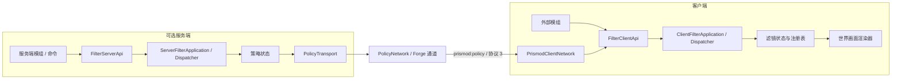

<div align="center">

# Prismod

### Minecraft 客户端世界画面滤镜模组


**Prismod 1.1** 是一个面向 Minecraft Java Edition 1.20.1 的 Forge 客户端滤镜模组，并包含可选的服务端基础框架。
客户端只处理世界画面和手持物品，不会把 HUD、聊天、菜单或容器加入滤镜链；服务端部分只提供 API、命令和协议基础设施。

</div>

> [!NOTE]
> Prismod 的自定义资源包是模组自己的 v1 格式，不是 Minecraft 原版资源包。资源包放置在 `config/prismod/resourcepacks/`，不需要 `pack.mcmeta`。

## ✦ 项目简介

Prismod 提供一套可配置、可调试、可扩展的客户端世界滤镜：

- 内置原色、黑白、暖色、冷色、复古和夜视滤镜；
- F8 按配置顺序循环滤镜，自定义滤镜保留完整 `namespace:path` 身份；
- 独立的滤镜配置、滤镜可见性和资源包管理页面；
- 支持 PostChain 与 Adobe `.cube` LUT 资源；
- 支持滤镜强度调节、统一调试 uniform 和资源重载；
- 提供只依赖 `com.xkmxz.prismod.api.client` 的客户端 Java API；
- 提供可选的服务端 API、`/prismod help`、`/prismod status` 和版本化网络通道；
- 渲染失败时安全回退原色，并释放 PostChain、LUT 纹理和临时 framebuffer。

## ✅ 当前功能

| 功能 | 状态 | 说明 |
| --- | :---: | --- |
| 客户端专用加载 | ✅ | 只在物理客户端加载，不向专用服务端暴露客户端类 |
| 内置滤镜 | ✅ | 原色、黑白、暖色、冷色、复古、夜视 |
| F8 循环切换 | ✅ | 支持自定义循环顺序、改键和冲突提示 |
| 自定义资源包 | ✅ | 支持目录、ZIP、依赖检查和 namespace 去重 |
| PostChain / LUT | ✅ | 支持后处理链和 `LUT_3D_SIZE` 1 到 64 的 `.cube` |
| 资源包编辑器 | ✅ | 支持草稿、语言文件、滤镜模板、备份和原子保存 |
| 滤镜调试 | ✅ | 支持强度、曝光、对比度、高光、阴影、饱和度、色温、色调和伽马 |
| 客户端 Java API | ✅ | 注册、注销、强制滤镜和不可变状态快照 |
| 服务端基础框架 | ✅ | `/prismod help`、`/prismod status` 和可选版本化网络通道 |
| Oculus 共存 | 🧪 | 可选共存，具体 shaderpack 兼容性需要按版本实测 |

## 🧱 技术架构

客户端和服务端 API 都通过 `submit` 写入、`query` 读取：

- 客户端：`FilterClientApi` → `ClientFilterApplication` → 内部 dispatcher、状态管理和世界渲染器；
- 服务端：`FilterServerApi`/命令 → `ServerFilterApplication` → 内部 dispatcher、策略状态和 `PolicyTransport`；
- 滤镜只作用于世界画面和手持物品，HUD、聊天、菜单和容器保持原色。



`Application` 负责组合依赖和提供用例入口，`Dispatcher` 负责内部请求调度和结果交付。完整数据流和边界见 [API 架构与文档索引](docs/api/API_架构与文档索引.md)。

## 🎮 安装与运行

### 运行环境

- Minecraft Java Edition **1.20.1**
- Minecraft Forge **47.3.32**
- Java **17**
- 客户端环境；可选在专用服务端安装服务端框架

### 安装发行版

1. 使用 `1.20.1` 对应的 Forge 客户端。
2. 构建发行包：`build/libs/prismod-1.1.jar`。
3. 将 JAR 放入 Minecraft 的 `mods` 文件夹。
4. 启动游戏后，在世界内按 **F8** 循环切换滤镜。

可在“控制 → 按键绑定 → Prismod”修改 F8。打开界面时不会触发切换。

## 📦 自定义资源包

资源包目录：

```text
config/prismod/resourcepacks/
├─ example/
│  ├─ prismod.pack.json
│  └─ assets/example/
└─ example.zip
```

根目录必须包含 `prismod.pack.json`，并使用 `schema: prismod.resource_pack`、`format_version: 1`。清单中的 `filters` 是滤镜唯一来源，每个滤镜位于 `assets/<namespace>/filters/` 下并包含 `filter.json`。

资源包支持 `post_chain` 和 `lut3d`。PostChain、program JSON 和 GLSL 位于滤镜目录；LUT 的 `source` 指向同目录 `.cube`。调试滤镜需要在 pass、program 和 GLSL 中声明统一的九个 float uniform：

```text
Intensity, Exposure, Contrast, Highlights, Shadows,
Saturation, Temperature, Tint, Gamma
```

资源包管理页面支持拖入目录或 ZIP、手动打开资源包目录、启用/禁用资源包、创建空 v1 包和编辑已有资源包。编辑器使用草稿和原子保存，目录包与 ZIP 均保留版本备份；删除滤镜的内容进入统一回收目录。

内置默认包会在首次客户端资源重载时导出到 `config/prismod/builtin/prismod_default_filters/`。用户已经编辑的滤镜和语言文件不会覆盖，运行时辅助资源会随模组版本更新。

## ⚙️ 配置与界面

客户端配置文件：

```text
config/prismod/config/prismod-client.toml
```

主要字段：

| 字段 | 作用 |
| --- | --- |
| `enabled` | 总开关 |
| `cycle_order` | 滤镜循环顺序；内置滤镜可使用短名称，自定义滤镜使用 `namespace:path` |
| `custom_strengths` | 自定义滤镜强度，格式为 `namespace:path=value` |
| `disabled_packs` | 禁用的资源包 namespace |
| `hidden_filters` | 不在配置页和 F8 循环中显示的滤镜 |
| `strength_<id>` | 内置滤镜强度 |

客户端和服务端业务强度统一规范化到 `[0, 100]`；NaN 和无穷值按 `0` 处理。只有客户端渲染边界将百分制强度转换为 shader 底层数值。渲染不可用时临时原色优先，其次是有效强制滤镜，最后是玩家总开关和普通选择。回退不会丢失用户选择。

## 🔌 客户端 Java API

客户端公开门面 `FilterClientApi` 只保留 `submit` 和 `query`。请求返回一次最终回执，查询返回不可变视图；资源、订阅和 Session 的生命周期必须通过公开 API 管理，不要在客户端线程阻塞等待异步结果。

完整请求、查询、调参和线程约束见 [Prismod 客户端 API 规范](docs/api/Prismod_客户端_API_规范.md)。

## 服务端 API 与命令

服务端框架不会加载客户端渲染类。`FilterServerApi` 只保留 `submit(ServerFilterRequest)` 和 `query(ServerFilterQuery<R>)`，服务端回执表示策略已被服务端接受并保存，不是客户端渲染回执。

网络通道为 `prismod:policy`，现行协议为 `3`，协议 `2` 及更早版本不兼容，strength 使用 `0-100` 百分制。命令、请求模型和协议细节见 [Prismod 服务端 API、命令与协议](docs/api/Prismod_服务端_API_命令与协议.md)。

## 🛠️ 开发与构建

项目自带 Gradle Wrapper，无需预装 Gradle。

### Windows PowerShell

```powershell
.\gradlew.bat compileJava --console=plain
.\gradlew.bat test --console=plain
.\gradlew.bat build
.\gradlew.bat runClient
```

### Linux / macOS

```bash
./gradlew compileJava --console=plain
./gradlew test --console=plain
./gradlew build
./gradlew runClient
```

OpenGL shader 测试：

```powershell
.\gradlew.bat test -PprismodRenderTests --console=plain
```

GPU 性能诊断：

```powershell
.\gradlew.bat runClient -PprismodProfileGpu=true
```

### 验证范围

普通测试覆盖状态机、滤镜身份、线程安全快照、资源包扫描、注册表和 shader 资源关系。OpenGL 测试验证独立上下文中的 GLSL、像素、alpha 和滤镜成本，不替代 Minecraft 内 Mixin、HUD 或 Oculus 集成测试。

## 🧪 游戏内回归清单

1. 检查原色、五种内置效果的 `0`、`0.5`、`1` 强度，以及 HUD、聊天、背包和暂停菜单的原色显示。
2. 检查 F8 循环、改键、冲突提示、配置保存/取消、窗口缩放和低 GUI 分辨率。
3. 检查 F3+T、全屏切换、尺寸变化、退出/重进世界、资源损坏后的回退与重载恢复。
4. 使用另一个客户端模组调用 API，验证强制覆盖、解除恢复、非客户端线程调用和断开连接清除覆盖。
5. 分别在无 Oculus、安装但关闭 shaderpack、启用 shaderpack 时检查画面；记录未验证的兼容性。
6. 启动专用服务器，确认没有客户端类加载错误；再测试客户端连接未安装 Prismod 的服务器。

## 📚 项目文档

- [`docs/api/Prismod_客户端_API_规范.md`](docs/api/Prismod_客户端_API_规范.md)：客户端 API、注册生命周期和线程约束。
- [`docs/api/Prismod_服务端_API_命令与协议.md`](docs/api/Prismod_服务端_API_命令与协议.md)：服务端 API、管理命令、测试命令和网络协议。
- [`docs/api/API_架构与文档索引.md`](docs/api/API_架构与文档索引.md)：跨端架构边界和当前规范文档索引。
- [`docs/Prismod_资源包格式与编辑指南.md`](docs/Prismod_资源包格式与编辑指南.md)：资源包 v1、PostChain、LUT 和调试 uniform。
- [`PRISMOD_GUIDE_PROMPT.md`](PRISMOD_GUIDE_PROMPT.md)：项目架构、边界和开发约定。

## 📄 许可证

本项目采用 **ARR（All Rights Reserved，保留所有权利）**。除非获得版权所有者事先书面授权，不得复制、修改、再发布、商业使用或制作衍生作品。完整条款见 [`LICENSE`](LICENSE)。

ARR 不是 OSI 认可的开源许可证；源码可见不代表自动授予自由使用、修改或分发的权利。Minecraft、Forge 及其他第三方依赖仍适用各自许可证。

## 💬 反馈与问题

提交 Issue 时请附上：

- Minecraft、Forge 和 Java 版本；
- 操作系统、显卡和驱动信息；
- `run/logs/latest.log` 中与 `prismod` 相关的片段；
- 是否启用了 Oculus、shaderpack 或自定义资源包；
- 可稳定复现问题的最小步骤。
