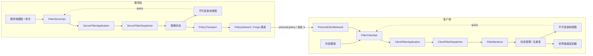

# Prismod API 架构与文档索引

本文概述 Prismod 客户端与服务端 API 的边界和数据流，并指向各领域的规范文档。它不是 API 调用手册；具体类型、参数、命令和示例以专题文档为准。

## 架构边界

- 客户端只处理世界画面和手持物品，不把 HUD、聊天、菜单或容器加入滤镜链。
- 客户端公开 API 仅在物理客户端使用；专用服务器路径不得加载 `net.minecraft.client` 或 `api.client`。
- 两端 API 共用 `submit` 写入和 `query` 读取的入口风格。请求、回执和查询视图是 API 契约；应用层和渲染、网络实现均为内部实现。
- 客户端和服务端 strength 统一使用 `0-100` 百分制，客户端渲染边界负责转换为 shader 所需数值。

## 数据流

`Application` 是 API 与命令共用的组合根，负责组装运行依赖并向外提供用例入口；内部 `Dispatcher` 是用例执行核心，负责请求调度、业务执行和结果交付。命令适配器调用公开 API，不直接操作策略状态或网络实现。

服务端网络通道为 `prismod:policy`，现行协议为 `3`；协议 `2` 及更早版本不兼容。网络仅下发策略，服务端成功回执不代表客户端已接收或渲染完成。

## 规范文档

- [Prismod 客户端 API 规范](Prismod_客户端_API_规范.md)：客户端请求、查询、回执、线程约束、资源生命周期和调参。
- [Prismod 服务端 API、命令与协议](Prismod_服务端_API_命令与协议.md)：服务端 API、管理/测试命令及网络协议。
- [Prismod 资源包格式与编辑指南](../Prismod_资源包格式与编辑指南.md)：Prismod v1 清单、目录、PostChain、LUT 和调试 uniform。
- [项目开发约定](../../PRISMOD_GUIDE_PROMPT.md)：客户端/服务端边界、渲染约束、测试要求和维护规则。
- [API 问题索引](bug/INDEX.md)：当前已知 API 缺陷和设计限制；历史问题归入问题档案。
- [项目入口与安装（仅供人类）](../../README.md)：功能摘要、运行环境、配置、构建和文档导航；不属于 AI 规范来源。
